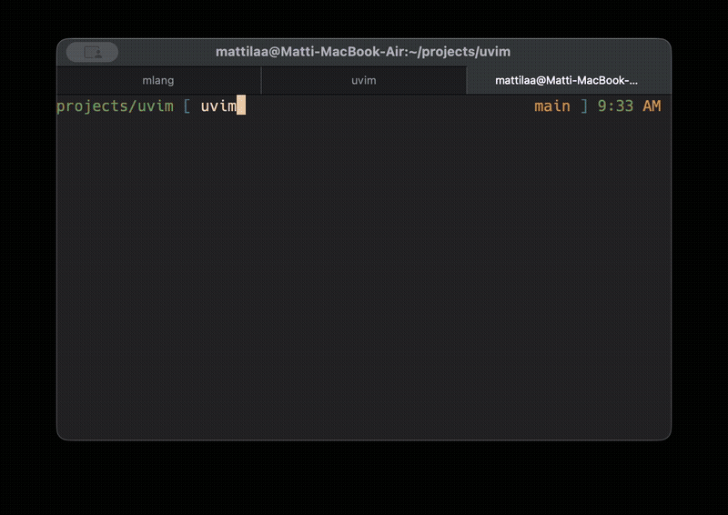

[](https://github.com/mattilaa/uvim/actions/workflows/ci.yml)
# uVim

uVim is a configurable, terminal-native modal code editor. It keeps familiar
vi/Vim navigation and editing, but the project now also includes project
search and indexing, file and buffer browsers, nested splits, Git views,
formatters, diagnostics, and optional language-server clients.

The same source tree can produce very different editors. `uvim-config` can
build a reduced vi-style binary for a virtual-terminal environment, a compact
editor with selected integrations, or the complete development build. Large
features are compile-time options, so reduced builds do not merely hide unused
menus—they leave the corresponding implementation out of the binary.

## Highlights

- vi-style normal, insert, replace, visual, text-object, mark, and jump flows
- syntax highlighting, tabs, buffers, file browser, and nested split panes
- cached Ctrl-P fuzzy file finding and multithreaded Ctrl-A project grep
- regex search in buffers and projects
- Git status, diff, log, stage, commit, blame, stash, and related views
- formatting and diagnostics for supported languages
- optional LSP clients for C/C++, Robot Framework, Python, Mlang, HTML, CSS,
  JSON, JavaScript, and TypeScript
- project-aware `compile_commands.json` and `mlang_commands.json` discovery
- configurable themes, terminal colors, clipboard support, assembly docs,
  command output browsing, and auxiliary developer views
- POSIX and native Windows terminal backends



## Contents

- [Release notes](#release-notes)
- [How to make a release](RELEASE_PROCESS.md#release-checklist)
- [Supported platforms and builds](#supported-platforms-and-builds)
- [Build profiles and uvim-config](#build-profiles-and-uvim-config)
- [Runtime configuration](#runtime-configuration)
- [Themes](#themes)
- [Generated documentation](#generated-documentation)
- [Assembly instruction docs](#assembly-instruction-docs)
- [Assembly browser](#assembly-browser)
- [LSP flags](#lsp-flags)
- [Dependencies](#dependencies-os-specific)
- [Command palette](#command-palette)
- [File browser](#file-browser)
- [`:run` output view](#run-output-view)
- [Tab bar and buffer management](#tab-bar--buffer-management)
- [Ctrl+Shift keys and Alt alternatives](#ctrlshift-keys-and-alt-alternatives)
- [Diagnostics](#diagnostics)
- [Search examples](#search-examples)
- [Function and local navigation](#function-and-local-navigation)

## Release notes

### v0.3.3 (2026-10-21)

#### Fixed

- **Responsive LSP startup and file opening** — language servers initialize
  in background tasks while editing and opening files remain responsive.
  The status bar reports startup, readiness and failure; `:lspinfo` shows
  servers that are still starting.
- LSP document updates use an ordered writer queue, preventing Windows pipe
  backpressure from freezing the editor when opening the first source file.
  C++ header-symbol indexing, compile-database discovery and include lookup
  also run outside the input and drawing paths.
- Child processes no longer inherit unrelated tool pipes. Starting a language
  server cannot keep a clipboard helper waiting for its input pipe to close.
- **Word-backward navigation** — Normal-mode `b` moves immediately, including
  repeated presses and counts such as `2b`, and no longer consumes the next
  key. Close buffers with `:bd` / `:bdelete`; bare `bd` is no longer a buffer
  shortcut.
- `j` / `k` and up/down arrows preserve the wanted column in UTF-8 mode,
  without drifting left on ASCII lines. Short lines clamp to a complete
  character and longer lines restore the wanted column.
- Windows CI's Python tests rediscover a missing interpreter after the build
  tree is transferred to another runner. Async LSP regression tests preserve
  exact log and document bytes across Windows and POSIX line endings.
- `uvim-config` requests the .NET 10 SDK when installing missing C# LSP
  prerequisites with apt, dnf or winget, matching current `csharp-ls`
  requirements. It checks installed SDK versions and offers SDK installation
  for runtime-only or older installations before installing `csharp-ls`.
  POSIX setup instructions explain dependency installation.

#### New and improved

- **Function signature browser** — `Space-o` or `:functions` opens a searchable
  list for the current buffer. Browse with `Ctrl-J/K`, jump with `Enter`, and
  cancel with `Esc`. Multiline signatures and unsaved edits are included.
  Signatures use syntax colors, and selected functions open centered in the
  editor by default; `:set gdcenter=false` selects minimal scrolling.
- Function and local code navigation: `]f` / `[f` jump between function
  signatures; `]s` / `[s` step through variable declarations and calls inside
  the current function. `n` / `N` repeat the selected navigation until Escape
  or a new search. Works without LSP for C/C++, Python, Mlang, JavaScript,
  TypeScript and C#.

#### Development

- Added a [project-local C# environment helper](docs/csharp_environment.md)
  for Windows, macOS and Linux: local SDK, LSP, NuGet caches and Python venv,
  a version manifest, and Hello World, LSP practice and class-library
  starters. A [step-by-step guide](docs/csharp_quickstart.md) covers creating,
  building, running and editing a project in uVim.
- Generated C# projects include `requirements-csharp.txt`; run
  `python csharp-env.py install -r requirements-csharp.txt` to install their
  SDK and language server locally, without sudo or global installations.
- Added a [small C# example project](examples/lsp/csharp/README.md) with
  instructions for testing highlighting, completion, definition jumps,
  references and diagnostics in uVim.
- Added dependency tests for C# installation with Homebrew, apt, dnf and
  pacman, plus regressions for navigation, slow LSP startup and pipe ordering.
- New pushes to `main` cancel its previous CI run; other branches keep their
  own queues and cannot cancel a running main pipeline. Branch push runs
  rebase their temporary checkout onto current `main` by default, controlled
  by the `CI_REBASE_BRANCHES` Actions variable. All jobs use one prepared
  source snapshot; remote branches are not rewritten.

### v0.3.2 (2026-10-19)

#### New

- **C#** — `.cs`/`.csx` files are highlighted in every build: keywords,
  contextual keywords such as `var`, `async`, `record`, built-in types,
  verbatim (`@"..."`), interpolated (`$"..."`) and raw (`"""..."""`) strings,
  `#region`-style directives and comments. Comment toggling uses `//` and
  `Format buffer` uses clang-format's C# mode.
- **PowerShell** — `.ps1`/`.psm1`/`.psd1` files are highlighted: keywords
  (case-insensitive), `Verb-Noun` cmdlets and function names, variables
  (`$x`, `$env:PATH`, `${...}`), `[type]` literals, `-eq`/`-match`-style
  operators, strings with backtick escapes, here-strings (`@"..."@`,
  `@'...'@`) and `#` / `<# ... #>` comments. Comment toggling uses `#`.
- **C# language server** (build option `UVIM_ENABLE_CSHARP_LSP`, in the
  `full` preset and the release binaries) — `csharp-ls` from `PATH` or
  `~/.dotnet/tools`, otherwise OmniSharp. It starts with the first `.cs` file
  in the folder of the nearest `.sln`/`.csproj`; completion, go to
  definition, references, diagnostics with `Space-e` and `:lspinfo` work as
  for C/C++. `--csharp-lsp`, `--csharp-lsp-path`, `--csharp-lsp-args`;
  `scripts/install_lsps.sh --csharp`. See [C#](#c).
- **`uvim-config` checks runtime dependencies** — after saving a
  configuration it lists the programs the chosen features use (language
  servers, git, ripgrep, fzf, formatters, clipboard helpers) and offers to
  install the missing ones with the system package manager, npm, pipx or
  `dotnet tool`; nothing is installed without a yes. `--check-deps` and
  `--install-deps` do the same without the configurator screen.

#### Development

- The version lives in [`version.txt`](version.txt); CMake reads it.
- [`scripts/release.sh`](scripts/release.sh) bumps the version (refusing a
  lower one), checks the release notes and publishes a release after
  checking the tag, the notes and CI; afterwards `main` moves on to the next
  version. See [RELEASE_PROCESS.md](RELEASE_PROCESS.md).
- CI builds the C# language server support and tests it against a real
  `csharp-ls` on Linux.

### v0.3.0 (2026-10-18)

#### New

- **Command palette** — `Space Space` (also in visual modes) or `:palette`
  opens a floating list of what uVim can do by name ("Open file browser",
  "Change buffer", "Save all files", "Git: log", ...) with the key or command
  that does the same. Type to filter, `Enter` runs it. See
  [Command palette](#command-palette).
- **Floating pickers** — `Ctrl-P` (find file) and `Ctrl-A` (grep) open as a
  Telescope-style floating window over the code with a syntax-highlighted
  preview; `Ctrl+Shift+J/K` (or `Alt-J/K`) scroll the preview, `:415` after
  the query opens the result at that line. `:set pickerstyle=fullscreen`
  keeps the old layout.
- **Background tasks with progress** — heavy work (project indexing, grep,
  LOC counting, LSP startup, external tools) runs in a task queue with
  progress bars in the status line; keys typed meanwhile are queued instead
  of freezing the UI. `:tasks` lists, reorders and cancels jobs; LSP servers
  show their own progress. `uvim .` starts without blocking.
- **`:sc` / `:showchanges`** — the unsaved edits of the buffer as a colored
  diff, with `n`/`N` hunk navigation (wrapping around), `d` to drop a hunk
  and `u` to undo.
- **Edit commits from `:git log`** — open a commit, drop hunks from it,
  review the new commit (`v`) and rewrite it (`c`); undo restores the
  original commit.
- **Alt keys for Ctrl+Shift chords** — on terminals without the kitty
  keyboard protocol (macOS Terminal, Windows PowerShell, ...) `Alt-H/J/K/L/X`
  do what `Ctrl-Shift-H/J/K/L/X` do. `:set iskitty=true/false`, detected
  automatically. See [Ctrl+Shift keys](#ctrlshift-keys-and-alt-alternatives).
- **Yank once, replace many** — `yiw` then `viwp` on other words keeps the
  yanked word for further replacements; visual `Y`.

#### Improved

- `:` command line: `Tab` takes the highlighted entry of the command list,
  fuzzy matches included (`:lcto` → `:loctotal`).
- Typing a complete command (`:q`) runs it even if another entry of the
  command list is highlighted.
- File lists in Ctrl-P, grep and regex search are sorted the same way on
  every platform.
- `:toolinfo` lists the discovered formatters.
- Syntax highlighting: `likely`/`unlikely`, `let`, `.mla` comments.
- `uvim --version` prints the release version and build number
  (`uvim 0.3.0 (build N)`).

#### Fixed

- **`:q`, `:qa` and `:qall` quit without saving** when a buffer had unsaved
  changes; they now refuse with "No write since last change".
- Keys typed right after `Esc` (`<Esc>:wq` typed quickly) were lost.
- Status bars of browser views could show garbage (use after free).
- Builds without LSP support did not compile.
- Unsaved-changes marker stayed after formatting and undo.
- Git commit view cursor/row offset; status line rows in help views.
- Windows: garbled (code page 850) picker preview, quitting could hang on
  clangd shutdown, git tools did not build.

#### Platforms and installation

- **Windows x64** builds (MSVC) with clangd LSP support, tested in CI.
- **Linux arm64** release builds next to Linux x86_64.
- **macOS** releases are arm64 (Apple silicon).
- **Windows installer** (`…-windows-x86_64-setup.exe`): per-user install,
  optional PATH entry, Start menu shortcut that opens uVim in a Windows
  Terminal window with a uVim profile (or a PowerShell window), and
  "uVim launcher settings" to change that later.
- **macOS installer** (`.pkg`): optional **uVim app** in Applications that
  opens uVim in Alacritty when installed, otherwise Terminal; files dropped on
  it open in uVim.
- See [Supported platforms and builds](#supported-platforms-and-builds).

#### Development

- CI builds and tests Linux, macOS (also with ASan/UBSan) and Windows in a
  build stage and a test stage, makes Release binaries for every target and
  cancels older runs on new pushes to `main`, and queues runs on other branches.
- Release tags must match the version in `CMakeLists.txt`; the release
  scripts and the `uvim_version` test check it.
- New clangd integration test; Robot tests report why uVim exited or hung.

## Supported platforms and builds

uVim supports three operating systems on two CPU architectures. Other
architectures (32-bit x86, ARMv7, RISC-V, macOS on Intel, Windows on ARM,
...) are not supported.

| Platform | Architecture | Compiler        | Terminal backend        |
|----------|--------------|-----------------|-------------------------|
| Linux    | x86_64       | GCC (or Clang)  | POSIX                   |
| Linux    | arm64        | GCC (or Clang)  | POSIX                   |
| macOS    | arm64        | Apple Clang     | POSIX                   |
| Windows  | x86_64       | MSVC            | native Windows console  |

The terminal backend follows the platform (`UVIM_TERMINAL_BACKEND=AUTO`).
On Windows only the native console backend works; choosing `POSIX` there
stops at configure time.

### Continuous integration

Every push and pull request runs [CI](.github/workflows/ci.yml). After source
preparation, build jobs run in parallel, followed by the test stage:

```text
 build stage                                   test stage
 build linux-x64 (Debug, GCC, clangd LSP)  ──▶  test linux-x64        unit + Robot, real clangd
 build macos-arm64 (Debug)                 ──▶  test macos-arm64      unit + Robot
 build macos-arm64-asan (Debug, ASan/UBSan)──▶  test macos-arm64-asan unit + Robot under sanitizers
 build windows-x64 (Debug, MSVC, LSP)      ──▶  test windows-x64      unit, real clangd
 artifacts linux-x64    (Release)  → uvim-linux-x64.tar.gz
 artifacts linux-arm64  (Release)  → uvim-linux-arm64.tar.gz
 artifacts macos-arm64  (Release)  → uvim-macos-arm64.tar.gz
 artifacts windows-x64  (Release)  → uvim-windows-x64.zip
```

- New pushes to `main` automatically cancel its previous CI run and start
  testing the latest commit. Other branches queue runs: while one runs,
  further pushes wait as a single run of the newest commit.
- Cancellation and queueing are scoped to the same branch. Pushing to `dev`
  leaves a running `main` pipeline running, and pushing to `main` leaves
  pipelines on other branches running.
- Branch push runs rebase their temporary checkout onto the latest `main`
  when the run starts, including queued runs and full workflow reruns. This
  defaults to enabled; set the repository Actions variable `CI_REBASE_BRANCHES`
  to `false` to disable it (Settings → Secrets and variables → Actions →
  Variables). Branches on GitHub are not rewritten. Rebase conflicts fail the
  run and must be resolved on the branch. Main and pull-request runs keep
  their triggering checkout.
- **prepare** creates one Git bundle of the prepared source for all Debug,
  test, and Release jobs. Every job uses the same commit even if `main`
  advances during the run; the prepare job summary records the original,
  main, and tested commits. Rerunning only failed jobs reuses that snapshot.
- **build** compiles the Debug builds with tests and hands the build tree to
  the test stage; Debug builds exist only to run the tests.
- **test** starts once the builds are done and runs the tests on those build
  trees without compiling again.
- **artifacts** makes the Release builds; each binary is attached to the CI
  run as an artifact named `uvim-<target>` (Actions → the run →
  *Artifacts*). Release builds include the clangd LSP client; the language
  servers themselves are external programs (see
  [Dependencies](#dependencies-os-specific)).

### Tagged releases

Pushing a `vMAJOR.MINOR.BUGFIX` tag runs the separate
[portable release workflow](.github/workflows/portable-release.yml). It makes
**Release builds only** (no debug builds) for every supported target, in
parallel, and attaches them to the GitHub Release page with a `.sha256`
checksum each (the workflow run itself keeps them as `release-<target>`
artifacts):

| Target         | Asset (for `v0.3.3`)                                   |
|----------------|--------------------------------------------------------|
| Linux x86_64   | `uvim-v0.3.3-linux-x86_64.zip` (static executable)     |
| Linux arm64    | `uvim-v0.3.3-linux-arm64.zip` (static executable)      |
| macOS arm64    | `uvim-v0.3.3-macos-arm64.zip`, `uvim-v0.3.3-macos-arm64.pkg` |
| Windows x86_64 | `uvim-v0.3.3-windows-x86_64.zip` (static MSVC runtime), `uvim-v0.3.3-windows-x86_64-setup.exe` (installer) |

The version lives in one place: [`version.txt`](version.txt) in the
repository root (`MAJOR.MINOR.PATCH`). CMake reads it (and reconfigures when
it changes), `uvim --version` prints it (`uvim 0.3.3 (build 12)` — the build
number is not part of the release version), the `uvim_version` test checks
that, and the release scripts stop when a tag does not match it.

The whole procedure — notes, publishing, checking, re-runs and fixes — is
described in [RELEASE_PROCESS.md](RELEASE_PROCESS.md). In short,
`scripts/release.sh` does the steps (it asks before every change; `-y`
answers yes):

```sh
scripts/release.sh --bump            # shows the current version and the
                                     # latest release, asks for the new one
scripts/release.sh --bump minor      # or major / patch / 0.4.0
scripts/release.sh --check-notes     # release notes done for this version?
scripts/release.sh --publish         # tag and publish the GitHub release
```

- `--bump` refuses a version that is not higher than the current one and the
  latest release, updates `version.txt` and the version examples (not the
  release-notes history), adds a `### vX.Y.Z (unreleased)` stub with a TODO
  to the release notes and commits "Version X.Y.Z".
- `--publish` runs on an up-to-date, clean `main`: it checks that the tag is
  new, that the release notes for the version exist without TODOs (and
  offers to replace "unreleased" with today's date), that CI passed for the
  commit (or waits for it), then pushes the tag `vX.Y.Z`; the release
  workflow builds every target and publishes the release with those notes.
  Afterwards it offers to move `main` on to the next patch version (bump,
  release-notes stub, commit, push), so `main` is never still the released
  number.

See [Portable archives](#portable-macos-and-linux-archives) for building
them locally.

## Build profiles and uvim-config

`uvim-config` is the supported front end for selecting a build profile and
overriding individual CMake features. It works as an interactive terminal TUI
and as a non-interactive command-line tool.

### Presets

| Preset | Intended use | Included | Compiled out or disabled |
| --- | --- | --- | --- |
| `vi-real` | Small vi-style binary for VT-compatible terminals, recovery environments, remote machines, and minimal installations | Core modal editing, welcome screen, tabs, built-in file and buffer browsers | Colors, modern bindings, nested panes, auxiliary views, Git, search/indexing, formatters, clipboard, assembly browser/docs, LSP, tests, and compile database output |
| `vi-min` | Small colored terminal editor with a few modern conveniences | `vi-real` editing/browser base plus terminal colors, color tools, modern bindings, and nested panes | Git, fuzzy/grep/regex tools, formatters, clipboard, auxiliary views, assembly browser/docs, LSP, tests, and compile database output |
| `minimal` | Compact modern editor without language servers | Browsers, auxiliary views, Git, cached search, formatters, clipboard, colors, and nested panes | LSP, assembly browser/docs, struct-size popup, tests, and compile database output |
| `basic` | Normal development build when LSP support is not needed | Editor features, browsers, Git, search, formatters, clipboard, assembly docs, auxiliary views, tests, and compile database output | Assembly browser and all language-server clients |
| `full` | Complete uVim development environment | All editor features, tests, compile database output, and every available LSP client | Sanitizers, debug logging, stripping, and static linking remain opt-in build modes |

`vi-real`, `vi-min`, and `minimal` select `-Oz`, LTO, dead-code section
collection, and binary stripping. `basic` and `full` default to Release with
`-O2`, LTO, and dead-code section collection. Presets are starting points;
later `--enable` and `--disable` arguments override individual choices.

The `full` preset compiles the LSP integrations into uVim. Language servers
such as `clangd` and the VSCode language servers remain separate programs and
must be installed on the target system when those integrations are used.

### Quick start: interactive configurator

On macOS, Linux, or WSL, `bootstrap.sh` builds the configurator and prompts to
run it and then build uVim. It first checks for CMake, Git, a C/C++20
toolchain, and Ninja or Make. If anything is missing, it offers to install the
required packages using Homebrew, apt, dnf, pacman, zypper, or apk:

```sh
./bootstrap.sh
```

For a non-interactive one-line setup, approve dependency installation in
advance:

```sh
./bootstrap.sh --install-deps
```

Use `--no-install-deps` when bootstrap should only report missing tools and
must not invoke the system package manager.

The equivalent explicit steps are:

```sh
./bootstrap.sh
./build/uvim-config
./build.sh
```

On native Windows PowerShell:

Use `.\bootstrap.ps1`, `.\build\uvim-config.exe`, and `.\build.ps1` for the
same workflow in native Windows PowerShell.

`bootstrap` builds only the configurator and offers to launch it. In the TUI:

- use `j`/`k` or the arrow keys to move
- use `h`/`l` to close or open a section
- press Space or Enter to toggle/cycle an option
- press Space or Enter on build jobs or install directory to edit the value
- press `s` to save and `q` to quit

The first save creates two files in the selected build directory:

- `uvim-config.conf` is the editable/importable profile state
- `uvim_config_cache.cmake` is the generated CMake cache initializer

The TUI reloads `uvim-config.conf` on the next run. `build.sh` imports it,
regenerates the CMake cache, configures the project, and builds with the saved
parallel job count.

#### Runtime dependencies of the chosen features

When you leave the TUI with a saved configuration (before `bootstrap` asks
about building), `uvim-config` lists the external programs the chosen
features use and whether they are installed:

```text
Runtime dependencies of the chosen features:
  [ok]       clangd  (C/C++ LSP)
  [missing]  .NET SDK (dotnet)  (C# LSP)
  [missing]  csharp-ls  (C# LSP)
  [ok]       ripgrep  (project grep (Ctrl-A))
  [optional] ruff  (Python formatting)

To install:
  .NET SDK (dotnet): brew install --cask dotnet-sdk
  csharp-ls: dotnet tool install --global csharp-ls
  ruff: brew install ruff

Install the missing dependencies? [a]ll, [s]elect each, [n]o (n):
```

Nothing is installed unless you answer `a` (all) or `s` (asks `y/N` for each
one). The install commands use the system package manager (Homebrew, apt,
dnf, pacman, winget) or the tool's own installer (`npm`, `pipx`/`pip`,
`dotnet tool`); prerequisites such as Node.js or the .NET SDK come first, and
an install whose installer is still missing is skipped. `[optional]` tools
improve a feature that works without them (ripgrep, fzf, formatters,
clipboard helpers).

The same check without the TUI:

```sh
./build/uvim-config --check-deps      # only list
./build/uvim-config --install-deps    # list and ask
```

### Quick start: preset from the command line

First bootstrap `uvim-config` and decline the prompt to open its TUI, then
select a preset from the command line:

```sh
./bootstrap.sh
./build/uvim-config --preset full --config Release --jobs 8
./build.sh
```

Build the reduced vi-style profile:

```sh
./build/uvim-config --preset vi-real --config Release -O Oz --jobs 8
./build.sh --target uvim
```

For the smallest profile, the built-in file and buffer browsers can also be
removed:

```sh
./build/uvim-config --preset vi-real --disable browser-tools
./build.sh --target uvim
```

Build and install the full profile on POSIX:

```sh
./build/uvim-config --preset full --install-dir ~/.local/bin --install
./build.sh --user-install
```

The user installation does not require administrator access. For `uvim` to
work directly by name, `~/.local/bin` must be on `PATH`. If it is not, add this
to `~/.zshrc`, `~/.bashrc`, or the appropriate shell profile and open a new
terminal:

```sh
export PATH="$HOME/.local/bin:$PATH"
```

For a system-wide POSIX installation, use:

```sh
./build.sh --system-install
```

This installs `/usr/local/bin/uvim` and requests `sudo` only for the install
step. A custom destination remains available with
`./build.sh --install --install-dir /path/to/bin`. The macOS `.pkg` release is
also a system-wide installer and places `uvim` in `/usr/local/bin`.

Equivalent PowerShell commands use `uvim-config.exe` and `build.ps1`.

### Terminal target selection

`--platform AUTO` is recommended and selects the native backend for the build
host. Use `--platform POSIX` for Unix terminals and PTYs, or `--platform WIN32`
for a native Windows console build. The Windows backend enables virtual
terminal processing and writes UTF-8 console text, allowing the same editor UI
to run in Windows Terminal and other compatible terminal hosts.

The `vi-real` preset disables optional terminal coloring but still requires a
terminal capable of full-screen cursor movement and raw key input. It is aimed
at VT-compatible terminal emulators rather than line-only or `TERM=dumb`
sessions.

Examples:

```sh
./build/uvim-config -p vi-real --platform POSIX -O Oz
./build/uvim-config -p full --platform AUTO -c RelWithDebInfo
```

```powershell
.\build\uvim-config.exe -p vi-real --platform WIN32 -O Oz
.\build.ps1 --target uvim
```

### Customize a preset

Options after `--preset` modify the selected profile:

```sh
# Compact editor with project search, but without Git or clipboard support.
./build/uvim-config -p minimal --disable git --disable clipboard

# Basic build plus only the C/C++ language server client.
./build/uvim-config -p basic --enable clangd

# Reload a saved profile and change one output option.
./build/uvim-config --import build/uvim-config.conf --disable tests
```

Available feature names include `browser-tools`, `auxiliary-views`, `git`,
`search`, `rg-cache`, `formatters`, `clipboard`, `asm-view`, `asm-docs`, `struct-size`,
`color-tools`, `terminal-colors`, `modern-keybindings`, `multi-pane-splits`,
`per-pane-lsp`, `clangd`, `robot-lsp`, `python-lsp`, `mlang-lsp`,
`mlang-semantic-tokens`, `html-lsp`, `css-lsp`, `json-lsp`, `ts-lsp`, `tests`,
`compile-commands`, `auto-build-number`, `lto`, `gc-sections`, `strip`,
`static-link`, `sanitizers`, `debug-logging`, and `debug-lsp`.

Run this for the authoritative option list:

```sh
./build/uvim-config --help
```

Other useful arguments are `--build-dir`, `--source-dir`, `--output`,
`--import`, `--jobs`, `--ninja`/`--no-ninja`, `--install-dir`, and `--install`.
For example, an isolated build directory can be used throughout:

```sh
./bootstrap.sh --build-dir out/full --jobs 8
./out/full/uvim-config -p full -B out/full -j 8
./build.sh --build-dir out/full
```

The generated cache can also be used directly:

```sh
cmake -C build/uvim_config_cache.cmake -S . -B build
cmake --build build --parallel 8
```

### Direct CMake configuration

Advanced builds may bypass `uvim-config` and set the `UVIM_*` CMake options
directly. For example:

```sh
cmake -S . -B build \
  -DCMAKE_BUILD_TYPE=Release \
  -DUVIM_MINIMAL=ON \
  -DUVIM_ENABLE_BROWSER_TOOLS=ON \
  -DUVIM_OPTIMIZATION_LEVEL=Oz
cmake --build build --target uvim --parallel 8
```

See the options near the top of `CMakeLists.txt` or the generated configuration
reference for the complete list. `UVIM_MINIMAL=ON` is a hard compile gate that
forces most optional integrations off; use the individual feature switches
when constructing a custom profile between `vi-real` and `full`.

### Portable macOS and Linux archives

Build a release archive for the current host:

```sh
./scripts/build_portable.sh
```

The default `full` profile is packaged as a ZIP file under `dist/` with the executable,
themes, README, license, dependency report, and SHA-256 checksum. Linux
requests a statically linked executable by default. macOS validates that the
binary links only to Apple system libraries. Supported macOS builds are
`arm64` (Apple silicon); `--macos-arch arm64` selects it explicitly when
building on another host. Portable macOS builds target macOS 13.3 or newer by
default:

```sh
./scripts/build_portable.sh --profile basic --macos-arch arm64
```

Run the script on macOS for a macOS archive and on Linux for a Linux archive.
Use `--dynamic` if a Linux toolchain does not provide static runtime libraries.
On Windows (x64, Visual Studio with the C++ workload) use the PowerShell
counterpart, which builds with the static MSVC runtime:

```powershell
./scripts/build_portable.ps1 -Profile full
```

Git, ripgrep/fzf, formatters, clipboard helpers, and language servers remain
optional external programs discovered through `PATH`.

Pushing a tag matching `v*` runs the portable-release GitHub Actions workflow:
it builds Release archives for Linux `x86_64` and `arm64`, macOS `arm64` and
Windows `x86_64` in parallel, creates the GitHub Release, and attaches the
archives and their checksums. Release tags must use `vMAJOR.MINOR.BUGFIX`,
for example `v0.3.3`. The public release keeps that three-part version. Build
numbers are never included in release asset names: the ZIP files are
`uvim-v0.3.3-linux-x86_64.zip`, `uvim-v0.3.3-linux-arm64.zip`,
`uvim-v0.3.3-macos-arm64.zip` and `uvim-v0.3.3-windows-x86_64.zip`. Running
the workflow by hand with `publish` unchecked only builds the archives.

The macOS job also creates `uvim-v0.3.3-macos-arm64.pkg`. It installs the
executable as `/usr/local/bin/uvim` and, optionally, the **uVim app** (see
below). The workflow builds this as an
unsigned installer by default, so it does not require a paid Apple Developer
membership or repository secrets. macOS may require the user to explicitly
approve the installer in Privacy & Security. If signing is added later, public
distribution should use a Developer ID Installer certificate and Apple
notarization.

#### Installing the unsigned macOS package

Only bypass Gatekeeper for a package downloaded from the official uvim GitHub
Release. Download both the `.pkg` and its matching `.pkg.sha256` file, then
verify them from the download directory:

```sh
shasum -a 256 -c uvim-v0.3.3-macos-arm64.pkg.sha256
```

After a successful checksum, double-click the `.pkg`. If macOS blocks the
unsigned installer, leave the warning open or dismiss it, open **System
Settings > Privacy & Security**, scroll to **Security**, and click **Open
Anyway** for the uvim package. Authenticate when prompted and confirm the
installer again. Apple makes **Open Anyway** available for about an hour after
the blocked launch attempt. Do not disable Gatekeeper globally. See Apple's
[security override instructions](https://support.apple.com/guide/mac-help/open-an-app-by-overriding-security-settings-mh40617/mac).

The installer's **Customize** page has two parts:

- **uVim command-line editor** (always installed) — `uvim` in
  `/usr/local/bin`; run it in any terminal.
- **uVim app** (selected by default) — `/Applications/uVim.app` with the uVim
  icon. It opens uVim in its own terminal window: **Alacritty** when it is
  installed, otherwise **Terminal**. Files dropped on the app (or opened with
  *Open With → uVim*) open in uVim. uVim runs in your login shell, so the
  `PATH` from your shell profile (Homebrew, git, ripgrep, ...) applies, and the
  window stays at a shell prompt after you quit uVim.

To pick the terminal yourself instead of the automatic choice:

```sh
defaults write io.github.mattilaa.uvim.app Terminal -string terminal    # always Terminal
defaults write io.github.mattilaa.uvim.app Terminal -string alacritty   # always Alacritty
defaults delete io.github.mattilaa.uvim.app Terminal                    # automatic again
```

Build the package locally after a portable build with
`./scripts/build_macos_pkg.sh --binary build-portable/uvim --version v0.3.3`.
The icons come from `packaging/icons/make_icons.py`.

#### Installing on Windows

The Windows release also has an installer,
`uvim-v0.3.3-windows-x86_64-setup.exe` (a separate `release-*-installer`
artifact in the workflow run). It is a normal setup wizard:

- installs uVim for the current user (no administrator rights needed) or,
  if chosen, for all users;
- optionally adds `uvim` to `PATH`, so it runs from any terminal;
- creates a **uVim** Start menu shortcut (and optionally a desktop one) that
  opens uVim in its own window, plus **uVim launcher settings**;
- uninstalls cleanly from *Settings → Apps*.

The wizard asks how the **uVim** shortcut opens uVim:

- **Windows Terminal window with a uVim profile** (default when Windows
  Terminal is installed) — the installer adds a "uVim" profile with its own
  name, icon and font to Windows Terminal, without editing your Windows
  Terminal settings. Best rendering: UTF-8, true colour and glyphs.
- **Separate Windows PowerShell window** — for systems without Windows
  Terminal.

Either way uVim runs inside Windows PowerShell with your PowerShell profile
loaded, so the window stays at a PowerShell prompt after you quit uVim. To
change the choice later, open **uVim launcher settings** from the Start menu
(a small window with the same two options); running the installer again also
shows it.

The installer is not code-signed yet, so Windows SmartScreen may show
"Windows protected your PC": choose **More info → Run anyway**. Check the
download first with the matching `.sha256` file:

```powershell
(Get-FileHash uvim-v0.3.3-windows-x86_64-setup.exe -Algorithm SHA256).Hash
```

Build the installer locally (needs Inno Setup 6, e.g.
`winget install JRSoftware.InnoSetup`) after the portable build:

```powershell
./scripts/build_portable.ps1 -Version v0.3.3
./scripts/build_windows_installer.ps1 -Version v0.3.3
```

To add binaries to a release that already exists, open **Actions**, select
**Portable release binaries**, choose **Run workflow**, enter the release's
exact tag (for example `v0.3.3`), select the profile, and run it. The workflow
uploads or replaces the ZIP files and checksums on that release.

## Runtime configuration

Generate the default runtime config:

```sh
uvim --init-config
```

This writes `~/.config/uvim/config.toml`, or
`$XDG_CONFIG_HOME/uvim/config.toml` when `XDG_CONFIG_HOME` is set, and copies
the bundled themes into the adjacent `themes/` directory. A custom destination
may be supplied explicitly:

```sh
uvim --init-config /path/to/uvim.toml
```

Build configuration and runtime configuration are separate: `uvim-config`
chooses which code is compiled into the binary, while `config.toml`, command
line flags, and `:set` options control the compiled features at runtime.

## Themes

Built-in theme examples are in `themes/`. Copy a theme into the runtime theme
directory and reference it in `config.toml`:

```toml
[theme]
name = "solarized-dark"
```

A custom theme can also be loaded directly:

```sh
uvim --theme /path/to/theme.toml
```

## Generated documentation

Generate the configuration/API reference with:

```sh
./scripts/build_docs.sh
```

The output is written to `docs/doxygen/html/index.html`. Published docs are
available at <https://mattilaa.github.io/uvim/>. Doxygen can be installed with
the platform package manager (`brew install doxygen`, `apt-get install
doxygen`, or `dnf install doxygen`).

## Assembly browser

`:asm .` compiles the current C/C++ or Mlang (`.mla`) buffer, including unsaved edits, into a
read-only assembly view. `:asm` is the same command. Use a file path instead
of `.` to compile another file; if that file is already open, its in-memory
contents are used. The source buffer, cursor, and file on disk stay intact.

```vim
:asm .
:asm . -O2
:asm . --split -O2
:asm . --
:asm . --compiler gcc -O3 -march=native
:asm "src/my file.cpp" --compiler clang -O2 -I "include directory"
:asm . --compiler "/path/to/clang++" --raw -O0 -g
```

Mlang files automatically use `mlang` from `PATH`. Use `--compiler PATH` to select
another Mlang executable:

```vim
:asm src/example.mla --split -O2
:asm . --compiler mlang -O0
:asm . --target-arch aarch64
```

Mlang compilation uses `-S -g` for assembly and linked source-line highlighting,
with `-O0` unless you supply another optimization level. The flags popup shows
Mlang options for `.mla` files, including `--target-arch x86|x64|aarch64`.
C/C++ compilation databases are not used for Mlang; `mlang_commands.json` is an
indexing database rather than a source of compiler flags.

To preserve relative `mod` imports and `mlang.toml` discovery, Mlang snapshots
are created temporarily beside the original source file; its directory must be
writable. The snapshot is removed after success, failure, or cancellation.
Compiler output and generated indexing files use an isolated temporary working
directory, keeping the project's existing `mlang_commands.json` intact.

For C/C++, when a matching `compile_commands.json` entry is found, `:asm` uses its compiler,
flags and working directory. It checks the configured clangd compilation-database
directory first, then the source file's directory and ancestors (including common
build directories such as `build`, `build-debug`, and `cmake-build-debug`), followed
by the editor working directory and ancestors. Only entries for the requested
source file are used; the first matching entry wins. Both `arguments` and quoted
`command` entries are supported, with `arguments` preferred, as well as compiler
response files. Database input, object-output, and dependency-output flags are
removed for the temporary assembly compilation. A malformed database reports an
error. The status bar shows `compile_commands` when an entry is used.

Prompt flags override inherited settings: `:asm . -O2` replaces a database's
`-O0`/`-O3`, and prompt language standards and macro definitions take precedence.
Prompt include directories precede inherited directories of the same include kind.
Inherited relative paths use the database entry's working directory; paths typed
at the prompt remain relative to the editor working directory. Project-specific
flags can also be supplied manually when no matching entry exists.

`--compiler` overrides the database compiler and accepts Clang, GCC, Mlang, or a compiler
executable; `clang`/`gcc` select their C++ drivers for C++ files. Without a matching
C/C++ database entry, Clang is preferred with GCC as fallback. The default optimization
is `-O0` if neither the database nor prompt supplies an optimization level. Paths
and arguments containing spaces can be quoted. Use `--raw` to retain the full
assembler output. Target-specific options such as `-masm=intel` depend on the
selected compiler and architecture.

Typing `:asm . --` opens a popup of common compiler flags with descriptions.
Use up/down or `Ctrl-J/K` to select, then Enter or Tab to insert a flag and
continue editing the command. Enter again compiles. Type `--` again to add
another suggested flag. Escape cancels the entire command without compiling.
Flags can also be typed manually, including full options such as `--compiler`.

To inspect a selection, select source lines with `V` and `j/k` (or use `v`),
then enter `:asm . -O2`, optionally with `--split` or the `--` flag picker.
The full buffer is compiled to preserve includes and surrounding declarations;
only assembly mapped to the selected source lines is shown. Character selections
include every source line they touch. The title shows the selected line range,
and the source pane keeps the full file with its original line numbers. In the
split, the selected source range has a persistent muted blue background; green
marks the currently linked source line. Customize the range tint with
`selection_bg = "#28354e"` under `[theme.asm]` in your theme/config file.
Optimized-away selections show an explanation instead of a compile error.
Run `:asm .` from normal mode to browse the complete output again.

Instruction inspection prefers Compiler Explorer API documentation by default,
with the exact inspected instruction (for example `movq %rdi, %rax`) pinned
above the documentation. API operand forms and examples, when provided, appear
before summary/fetch metadata. The popup uses bold accent headings, neutral
help text, syntax colors for assembly examples, and dim references/fence markers.
Built-in help appears
immediately while cached/API documentation loads in the background, and remains
as a fallback if retrieval fails. Progress stays in the loading indicator without
a message in the popup body. Row changes wait for a 300 ms pause before
refreshing the inspector, keeping the previous documentation visible while
browsing. A loading indicator appears only if retrieval takes another 300 ms;
fast responses cancel it. Inspector requests do not show queue/download messages.
Use `:set asmdocsapi=false` for built-in help only,
or persist `asmdocsapi = false` under `[editor]` in `config.toml`.

The title shows the target architecture (for example `AArch64` or `x86_64`),
including cross-compilation targets. C/C++ uses the selected compiler's target
report and effective target/bitness flags; Mlang uses `--target-arch` or its
native default. If a compiler cannot report its target, the title shows `unknown`
unless explicit target flags identify it.

The view shows assembly row numbers, syntax colors, the compiler and options,
and the selected row. Symbols and instructions unrelated to the compiled source
use a dimming gradient while retaining syntax colors. Only instructions directly
mapped to a source line keep full brightness. Labels whose origin is inferred
from nearby code are lightly dimmed, external-file rows are dimmer with a subtle
dark red background, and rows with no source origin are darkest. This includes all unresolved labels and
directives, even when the compiler supplies no source mappings. When compiler debug information identifies an external
source, selecting its label or instruction shows a hint such as
`from helper.mla:12` in the status bar. Rows without origin information show
`no source mapping`; the editor does not guess a library name.
Use `:set asmdimunmapped=false` to disable dimming, or persist
`asmdimunmapped = false` under `[editor]` in `config.toml`. This works in both
compact and `--raw` assembly views. External-source backgrounds remain visible
when dimming is disabled; the active row keeps its cursor-selection background.
Customize the external tint in `config.toml` or your theme file:

```toml
[theme.asm]
external_bg = "#351c26"
```

Compilation runs in a background task; failures show the compiler diagnostics in
the view, and `q`/Escape can leave while it runs.

Use `--split` for a vertical source/assembly comparison, or press `v` in the
view to toggle it. The left pane shows the compiled source snapshot, including
unsaved edits. Both panes are read-only. Move between them with Ctrl-Shift-H/L,
or Alt-H/L when using `:set iskitty=false`, just like editor panes. On narrow
terminals, the focused pane fills the available width.

Browsing another row with `j/k`, arrows, paging, or `g/G` resets both panes to
the beginning of their lines. Switching panes or toggling split view also resets
horizontal scrolling. Use `h/l` to pan the current line and `0` to return it to
the beginning without changing rows.

Moving through source highlights all matching assembly rows with a subtle
green background and scrolls to the first match. Moving through assembly
highlights and reveals its corresponding source line. Syntax colors remain
visible over the tint. Both panes keep their selected row near the middle of
the viewport, with scrolling limited at the start and end of the file.
Source mapping comes from compiler debug line records;
comments, declarations, optimized-away lines, and instructions from other files
may have no match. The status bar shows the mapped source line or reports that
there is no source mapping. Compiler flags still control the generated code;
uvim adds DWARF line information for linking the panes.

| Keys | Action |
| --- | --- |
| `j` / `k`, down/up | Select the next/previous row in the focused pane |
| `h` / `l`, left/right | Scroll horizontally |
| Page Up/Down, `Ctrl-U/D` | Move a page/half page |
| `g` / `G`, Home/End | First/last row |
| `v` | Toggle source/assembly split |
| Ctrl-Shift-H/L (or Alt-H/L) | Focus source/assembly pane |
| `i` | Toggle the instruction inspector popup |
| `Ctrl-J/K` with inspector open | Scroll the instruction documentation |
| `q` / Escape | Exit the assembly view and return to the source |

The inspector follows the selected row while you navigate with `j/k`, using
the same x86/x64 and AArch64 instruction documentation as assembly `gd`.
Labels, directives and comments show a message when no instruction applies.
The browser is compiled only with `UVIM_ENABLE_ASM_VIEW=ON` and
`UVIM_ENABLE_AUXILIARY_VIEWS=ON`. It is enabled by default only in the `full`
configurator preset. Select **Assembly browser** in `uvim-config`, or use
`uvim-config --preset full --disable asm-view` to omit it (and `--enable asm-view`
to add it to a custom build). Direct CMake builds default the browser to OFF;
pass `-DUVIM_ENABLE_ASM_VIEW=ON` to include it. Disabling it removes the browser,
`:asm` command/completion, and compiler flag picker from the build.
Instruction help additionally requires `UVIM_ENABLE_ASM_DOCS`.
The existing `:emitasm [flags]` command still creates a separate editable `.s` buffer. See `:help asm`.

## Assembly instruction docs

Assembly instruction `gd` support is controlled by the CMake option
`UVIM_ENABLE_ASM_DOCS`. It is enabled by default.

Build with the default:

```sh
cmake -S . -B build
cmake --build build --parallel 8
```

Or enable it explicitly:

```sh
cmake -S . -B build -DUVIM_ENABLE_ASM_DOCS=ON
cmake --build build --parallel 8
```

To disable it:

```sh
cmake -S . -B build -DUVIM_ENABLE_ASM_DOCS=OFF
cmake --build build --parallel 8
```

Run uvim:

```sh
./build/uvim file.s
```

Usage:

- Open a `.s`, `.S`, `.asm`, or `.ASM` buffer.
- Put the cursor on an instruction row, for example `movq %rdi, %rax` or
  `ldr x0, [sp]`.
- Press `gd`.
- uvim opens a cached markdown instruction index and jumps to the matching
  instruction section. The index is generated from documentation text packed
  into the uvim binary, so this mode does not need network access.
- Press `Space-ga` to show the current instruction docs in a modal popup.
  Use `j/k` to scroll the popup and `q` to close it.

To additionally fetch and cache the Compiler Explorer/Godbolt asm
documentation for each instruction on first `gd`, run:

```sh
uvim --asm-docs-fetch file.s
```

This uses `curl` at runtime and calls the Compiler Explorer API, for example
`https://godbolt.org/api/asm/amd64/mov` or
`https://godbolt.org/api/asm/aarch64/ldr`. If that fetch fails or `curl` is not
available, uvim falls back to the packed local documentation index.

The cache is written to `$XDG_CACHE_HOME/uvim/asm-docs` when `XDG_CACHE_HOME`
is set, otherwise to `~/.cache/uvim/asm-docs`. You can override it with:

```sh
UVIM_ASM_DOCS_CACHE_DIR=/tmp/uvim-asm-docs uvim file.s
```

The default cached docs are generated from packed uvim-owned documentation text
with reference links for x86/x64 and AArch64 instructions. The
`--asm-docs-fetch` mode stores fetched Compiler Explorer docs separately under
`asm-docs/fetched/compiler-explorer/`.

## LSP flags

- `--clangd` enable clangd LSP
- `--ccdir <dir>` compile commands base dir/file for clangd
- `--cc-collect-all` recursively merge all `compile_commands.json` files
- `--cc-windows-to-wsl` rewrite Windows paths (`C:\...`) to WSL paths (`/mnt/c/...`)
- `--robot-lsp` enable Robot Framework LSP
- `--python-lsp` enable Python LSP
- `--mlang-lsp` enable Mlang LSP (optional; not distributed yet)
- Mlang LSP semantic-token coloring is on by default when Mlang LSP is built
  and enabled; disable it with `editor.syntax.mlang.semantic_tokens: false`
  or `:set nosyntax.mlang.semantic_tokens`.
- `--html-lsp` enable HTML LSP
- `--css-lsp` enable CSS LSP
- `--json-lsp` enable JSON LSP
- `--ts-lsp` enable TypeScript/JavaScript LSP
- `--csharp-lsp` start the C# LSP at launch (otherwise it starts with the
  first `.cs` file); `--csharp-lsp-path <server>` (default `csharp-ls`, or
  OmniSharp), `--csharp-lsp-args <args>`. See [C#](#c).
- `--no-git-index` disable git-backed indexing for fuzzy find and grep
- `--no-gitignore` disable `.gitignore` filtering for file browser, fuzzy find,
  grep, and other project scans

Local scaffold example:

```sh
./build/uvim --clangd --python-lsp --html-lsp --css-lsp --ts-lsp
```

Startup note:

- when you start directly into a directory browser with `uvim .`,
  auto-detected LSP startup is deferred until you open a file
- this keeps directory launch fast while preserving `autodetectlsps: true` for
  normal editing
- LSP diagnostics from servers are shown as row markers and can be opened with
  `Space-e` when the cursor is on a diagnostic row.
- Active-LSP diagnostics can be collected into the same kind of jump list with
  `Space-m e` for errors and `Space-m w` for warnings. In C/C++ files this uses
  clangd; in mlang files this uses mlangd.
- Use `:set emitlsp=false` or config `editor.emitlsp: false` to suppress
  LSP-emitted warning/error diagnostics without disabling other LSP features.

### uvim logging

uvim logging is compiled out by default. Build with one of these CMake options
to enable it:

```sh
cmake -S . -B build -DUVIM_DEBUG_LSP=ON
cmake --build build --parallel 8
```

Use `UVIM_DEBUG_LSP` for LSP startup/stderr/debug logging, or
`UVIM_DEBUG_LOGGING` for broader editor debug logging. LSP log rows include the
server signature after the timestamp, for example `[CLANGD]`, `[PYTHON]`, or
`[TS]`.

Default log locations:

- POSIX: `/tmp/uvim.log`
- Windows: `%USERPROFILE%\Documents\uvim\uvim.log`

Override the log file at runtime with:

```sh
uvim --log-file /path/to/uvim.log file.cpp
```

When logging is not enabled in the build, `--log-file` is accepted but no uvim
log rows are written.

### Optional: mlangd-mla logging (private builds)

When uvim launches `mlangd-mla`, you can enable server logging directly from
uvim CLI:

- `--enable-log`
- `--enable-log=info`
- `--enable-log=debug`
- `--enable-log=verbose`
- `--log-level <info|debug|verbose>` (implies `--enable-log`)
- `--log-colors` (colored level tags in server log lines)
- `--log-dir <dir>` (default log file is `/tmp/mlangd-mla.log`)

Log level behavior:

- `info`: includes `[INFO]`, `[WARN]`, `[ERROR]`
- `debug`: includes `info` + `[DEBUG]`
- `verbose`: includes `debug` + `[VERBOSE]` (all levels)

Examples:

```sh
uvim --mlang-lsp --enable-log
uvim --mlang-lsp --enable-log=debug
uvim --mlang-lsp --log-level verbose
```

Notes:

- These flags are passed through when uvim resolves `mlangd-mla`.
- If you force `mlangd` (C++ server), uvim-specific `mlangd-mla` logging flags
  are not injected.

## Dependencies (OS-specific)

uvim LSP helpers need Node.js (npm), Python, git, and clangd. Yarn is optional
if you prefer it over npm.

If you run `uvim` inside WSL, install these tools inside the WSL distro
terminal (`apt`/`pacman`), not only on Windows host (`winget`/`choco`).

### Language servers for Python + C/C++ + HTML/CSS/TS

Install these language servers:

```sh
npm install -g pyright vscode-langservers-extracted \
  typescript-language-server typescript
```

Then run:

```sh
uvim --clangd --python-lsp --html-lsp --css-lsp --ts-lsp
```

If you prefer `pylsp` instead of `pyright`:

```sh
python3 -m pip install --upgrade python-lsp-server
uvim --clangd --python-lsp --python-lsp-path pylsp --html-lsp --css-lsp --ts-lsp
```

### C#

For a new project, follow [Your first C# project with uVim](docs/csharp_quickstart.md).
It walks through generating Hello World, building and running it, editing
it in uVim, and trying LSP features. The cross-platform script includes
`--help`, a dependency manifest and several starter templates. See the
[local environment reference](docs/csharp_environment.md) for setup details.

C# files (`.cs`, `.csx`) are highlighted in every build. Builds with
`UVIM_ENABLE_CSHARP_LSP=ON` (`uvim-config --enable csharp-lsp`; the `full`
preset and the release binaries include it) also talk to a C# language server:

```sh
dotnet tool install -g csharp-ls        # needs the .NET 10 SDK or later
# or: ./scripts/install_lsps.sh --csharp
```

On POSIX (macOS/Linux), `uvim-config` can install the dependencies for you:

```sh
./build/uvim-config --preset full --check-deps
./build/uvim-config --preset full --install-deps
```

Choose `a` to install all missing dependencies or `s` to select the .NET SDK
and `csharp-ls`. The SDK is installed first with Homebrew, apt, dnf or pacman,
then `dotnet tool install --global csharp-ls` downloads the server. Linux
repositories must provide the SDK package; if yours does not, follow
[Microsoft's .NET installation instructions](https://learn.microsoft.com/dotnet/core/install/linux).
The dependency check uses `dotnet --list-sdks` to verify that a .NET 10+ SDK
is installed, as required by
[current csharp-ls](https://github.com/razzmatazz/csharp-language-server#quick-start).
If .NET is missing, runtime-only or older, `uvim-config` offers to install the
SDK before installing the server. Accept both installations when prompted;
if SDK installation fails or is declined, the server install is skipped.
To add C# to a smaller preset, use `--enable csharp-lsp`, or enable **C#** in
the TUI's language-server section.

- uVim uses `csharp-ls` from `PATH` or `~/.dotnet/tools`, otherwise
  OmniSharp (`OmniSharp -lsp`); `--csharp-lsp-path` picks another one.
- The server starts with the first `.cs` file you open, in the folder of the
  nearest `.sln` (else `.csproj`) above it, and loads that solution — the
  first load can take a while. `--csharp-lsp` starts it at launch instead.
- Completion, go to definition (`gd`, `Space d`), find references
  (`Space g r`), diagnostics as row markers with `Space-e` details, and
  `:lspinfo` work as for C/C++. Edits are sent to the server as you type.
- `Format buffer` (`Space f`) formats C# with clang-format.

Try the [small C# example project](examples/lsp/csharp/README.md) to check
highlighting, completion, definition jumps, references and diagnostics.

### macOS (Homebrew)

```sh
brew install node python git llvm yarn
```

Notes:
- clangd is included with `llvm` (add `/opt/homebrew/opt/llvm/bin` or
  `/usr/local/opt/llvm/bin` to `PATH` if needed).

### Debian/Ubuntu (apt)

```sh
sudo apt-get update
sudo apt-get install -y nodejs npm python3 python3-pip git clangd yarn
```

### Arch/Manjaro (pacman)

```sh
sudo pacman -S --noconfirm nodejs npm python python-pip git clang yarn
```

### Windows (winget)

```powershell
winget install OpenJS.NodeJS
winget install Python.Python.3
winget install Git.Git
winget install LLVM.LLVM
winget install Yarn.Yarn
```

### Windows (Chocolatey)

```powershell
choco install -y nodejs python git llvm yarn
```

### WSL with Windows build outputs (clangd)

If you run `uvim` inside WSL but your project/builds are on Windows drives
(for example `/mnt/c/dev/...`) and compile databases are generated by Visual
Studio/MSVC, use:

```sh
# inside WSL terminal
sudo apt-get update
sudo apt-get install -y clangd nodejs npm python3 python3-pip git
npm install -g pyright vscode-langservers-extracted \
  typescript-language-server typescript
```

Then run uvim:

```sh
uvim --clangd --cc-collect-all --cc-windows-to-wsl /mnt/c/dev/your-project
```

What this does:

- collects all `compile_commands.json` files recursively from the browsed
  Windows directory tree, for example under `/mnt/c/dev/your-project`
- rewrites Windows-style paths in compile database entries and command lines
- writes a merged db for clangd to `.uvim/clangd/compile_commands.json` under
  the directory where `uvim` was started in WSL
- when `--cc-windows-to-wsl` is used, uvim watches source compile databases for
  updates and refreshes `.uvim/clangd/compile_commands.json` automatically

Current behavior is WSL-specific:

- opening `/mnt/c/dev/your-project` starts the file browser in that directory
- clangd still reads the merged compile database from the WSL startup
  directory, not from `/mnt/c/...`

### VSCode language servers (HTML/CSS/JSON/TS)

These LSPs are Node-based. You can install them globally:

```sh
npm install -g vscode-html-language-server vscode-css-language-server \
  vscode-json-language-server typescript-language-server typescript
```

Then run uvim with autodetect (default) or explicit flags:

```sh
uvim --html-lsp --css-lsp --json-lsp --ts-lsp
```

### Install script

Use the helper script to install one or more LSPs (uses git+https for Node packages):

```sh
./scripts/install_lsps.sh --html --css --json --ts
./scripts/install_lsps.sh --robot --python
./scripts/install_lsps.sh --all
```

Note:
- `--python` in `install_lsps.sh` installs `python-lsp-server` (`pylsp`).
- uvim default Python LSP path is `pyright-langserver`; install `pyright` (npm)
  or run with `--python-lsp-path pylsp`.

### One-shot setup script (macOS/WSL/Ubuntu/Arch)

For Python + C/C++ + HTML/CSS/TS, you can use:

```sh
./scripts/install_dev_stack.sh
```

Optional (`pylsp` fallback):

```sh
./scripts/install_dev_stack.sh --with-pylsp
```

This script detects Homebrew/apt/pacman and, when running in WSL, installs
inside the WSL distro environment.

### Sample files (LSP smoke tests)

Sample files for HTML/CSS/JS/TS live in `examples/lsp/`:

- `examples/lsp/sample.html`
- `examples/lsp/sample.css`
- `examples/lsp/sample.js`
- `examples/lsp/sample.ts`

## Command palette

`Space Space` (or `:palette`), in normal and visual modes, opens the
command palette: a floating window
like the Ctrl-P file finder and Ctrl-A grep, with the search input on top.
It lists what uVim can do by name, with the key or command that does the same
shown on the right:

```text
Find file                  Ctrl-P
Open file browser          Space x
Change buffer              Ctrl-W
Save all files             :wa, :wall
Git: log                   :git log
...
```

Choosing an entry does exactly that — "Open file browser" acts like
`Space x`, "Change buffer" opens the `Ctrl-W` buffer view. After the named
actions come all other `:` commands, titled by what they do.

- **Type** to filter — `file br`, `change buf`, `save all`, `wa`, `git log`
  all work. Best matches come first: exact command, name or command prefix,
  every search word starting a word of the name, names containing the
  words, then fuzzy matches.
- **`Ctrl-J` / `Ctrl-K`** (or the arrow keys) move the selection,
  `PgDn`/`PgUp` move ten rows, `Ctrl-U` clears the search.
- **`Enter`** runs the selection. Entries marked `…` need an argument
  (Open file…, Save as…); Enter opens the command line with the command
  typed (`:e `) for you to finish.
- **`Esc`** (or Backspace on an empty search) closes the palette.

The palette follows the picker settings (`:set picker.width=`,
`picker.height=`, `pickerstyle=`). See `:help palette`.

## File browser

Open with `Space-x` (leader-x) or `:e .`. In the browser, use `:hs` for a
horizontal browser split and `:vs` for a vertical browser split.

Navigation:

- `j`/`k` - move cursor down/up
- `Enter` / `l` / `→` - open file or descend into directory
- `h` / `←` / `-` - go to parent directory
- `Ctrl-d` / `Ctrl-u` - half-page down/up
- `gg` / `G` - top/bottom
- `Ctrl-o` / `Tab` - history back / forward
- `cd` - chdir to current directory (then `:pwd` reports it)
- `.` - toggle hidden files
- `Ctrl-g` - toggle `.gitignore` filtering
- `r` / `Ctrl-l` - refresh
- `q` - close the active browser pane; the final pane exits to editor/welcome
- `Q` - exit browser and save the current browser pane layout

Selection (multi-file):

- `Space` - toggle selection on the cursor entry
- `Shift-V` - start/stop visual-line selection. Exiting with `Shift-V`
  keeps the range as persistent selection; you can then move the cursor
  and press `Shift-V` again to extend with another segment.
- `Esc` - cancel an in-progress visual selection (restores the prior set)
- Double-`Esc` - clear all selections (and any cut buffer)
- `Enter` with a non-empty selection - opens every selected file as a
  buffer (directories skipped, alphabetical order)

File operations:

- `n` - create new file (nested paths like `a/b/c.txt` are created with
  parent directories on confirmation)
- `Shift-D` - create new directory (`mkdir -p` semantics)
- `d` - delete selected entries (or the cursor entry) with confirmation
- `y` - yank selected entries (or the cursor entry) into the paste buffer
- `m` - cut selected entries into the paste buffer (move mode)
- `p` - paste buffer into the current directory (copy or move depending
  on whether `y` or `m` was used)
- `u` / `Ctrl-r` - undo / redo the last file operation
- `Shift-R` - rename the cursor entry

Command-mode entries:

- `:q` - exit file browser
- `:cd <path>` - change directory; `:cdr` jumps to project root
- `:pwd` - print working directory
- `:mkdir <name>` / `:md <name>` - create directory
- `:new <name>` / `:touch <name>` - create file (prompts to open or
  replace if it already exists)
- `:delete` / `:d` / `:rm` - delete cursor entry
- `:rename <name>` / `:r <name>` / `:mv <name>` - rename cursor entry
- `:/<regex>` / `:?<regex>` - regex match within the listing; `Ctrl-J`/
  `Ctrl-K` cycle matches, `Ctrl-Space`/`Ctrl-N` toggle selection on all
  matches
- `:run <cmd>` - run a shell command in the current directory and open
  the result in the run view (see below). Pressing `Tab` after `run `
  appends the currently selected files to the prompt, alphabetically and
  shell-quoted, so `:run zip a.zip` + `Tab` becomes `:run zip a.zip 'foo
  bar.txt' baz.txt ...`.

## :run output view

`:run <shell command>` (from the file browser command line) executes the
command in the current directory and opens its combined stdout+stderr in
a scrollable view. Inside the view:

- `j`/`k`, `Ctrl-d`/`Ctrl-u`, `gg`/`G` - cursor / scroll
- `Space` - toggle the cursor row's selection
- `Shift-V` - start/stop visual-line selection. Like the file browser,
  exiting with `Shift-V` keeps the range; pressing `Shift-V` again starts
  a new segment that extends the persistent selection. `Space` while
  visual is active commits the current range and exits visual.
- `Esc` while visual - cancel current segment (restore prior set)
- Double-`Esc` - clear all selection
- `y` - yank selected rows (or the cursor row if none) to the system
  clipboard and yank buffer; selection is preserved
- `/` - incremental search; matches highlight with grey background and
  black foreground, `n`/`Shift-N` cycle. `q` clears the highlight; press
  `q` again (or `Esc`) to exit the view.

Long output lines wrap on screen but count as a single logical row for
cursor movement and selection.

## Tab bar / buffer management

- Close a buffer with `:bd` / `:bdelete` (`:bd!` forces it). In Normal mode,
  `b` immediately moves to the previous word; `2b` moves back two words, and
  the next key runs normally. There is no bare `bd` buffer-close shortcut.
- Each tab shows the buffer index (e.g. `1:foo.cpp`). Toggle with
  `:set tabnumbers` / `:set notabnumbers` (default on). Persists in
  config under `editor.tabnumbers`.
- `:set showtabs` / `:set noshowtabs` - show/hide the tab bar entirely.
- `Ctrl-Shift-H` / `Ctrl-Shift-L` - same as above when no split is active.
  When multi-pane splits are enabled and a split is active,
  `Ctrl-Shift-H/J/K/L` jumps between panes.
  Ctrl+Shift needs a terminal that reports modifiers; elsewhere (Apple
  Terminal, Windows PowerShell, ...) use `Alt-H/J/K/L` with
  `:set iskitty=false` — see
  [Ctrl+Shift keys and Alt alternatives](#ctrlshift-keys-and-alt-alternatives).
- `Ctrl-h` / `Ctrl-l` - previous / next buffer (unchanged).
- `Ctrl-w` - browse open buffers for the active pane. Press `Enter` to open
  the selected buffer only in that pane.
- `Space-w c` - close the active split pane (`:close` and `:clo` are equivalent).

## Ctrl+Shift keys and Alt alternatives

Some uvim keys are Ctrl+Shift+letter chords. A terminal can only send them
when it reports key modifiers through the kitty keyboard protocol or xterm
`modifyOtherKeys` (uvim requests both at startup): kitty, WezTerm, ghostty,
foot, alacritty, recent xterm, iTerm2 with "Report modifiers using CSI u",
tmux with `extended-keys on`. Other terminals — macOS Terminal, the Windows
console / PowerShell, many others — send Ctrl+Shift+J exactly like Ctrl+J,
so the chords cannot reach uvim there.

On those terminals use **Alt** instead. It is still a single chord, no
leader key or extra keypress:

| Ctrl+Shift      | Alt     | Action                                                  |
|-----------------|---------|---------------------------------------------------------|
| `Ctrl-Shift-H`  | `Alt-H` | Focus pane left; move buffer left when there is no split |
| `Ctrl-Shift-L`  | `Alt-L` | Focus pane right; move buffer right when there is no split |
| `Ctrl-Shift-K`  | `Alt-K` | Focus pane above; scroll the Ctrl-P / Ctrl-A preview up |
| `Ctrl-Shift-J`  | `Alt-J` | Focus pane below; scroll the Ctrl-P / Ctrl-A preview down |
| `Ctrl-Shift-X`  | `Alt-X` | Close the matching buffers in the buffer browser        |

### `iskitty`

The Alt keys are controlled by the `iskitty` setting:

```text
:set iskitty=false   " Alt-H/J/K/L/X act as the Ctrl+Shift keys
:set iskitty=true    " Alt keys are plain Esc + key again
:set iskitty?        " show the current mode
```

or in `config.toml`:

```toml
iskitty = false
```

The default is detected at startup: `true` in kitty, WezTerm, ghostty, foot
and alacritty, `false` everywhere else.

How it behaves:

- **Ctrl+Shift always works** when the terminal reports it, whatever
  `iskitty` says. `iskitty=false` only *adds* the Alt keys, so it is safe to
  use in any terminal (including kitty).
- **Key hints follow the setting**, e.g. `[Alt+J/K: scroll preview]` instead
  of `[Ctrl+Shift+J/K: scroll preview]`.
- **Esc then a letter stays two keys.** Terminals send Alt+J as Esc and `j`
  in one write; uvim treats it as the chord only when the letter arrives
  together with the Esc, so typing Esc and then `j` is not affected.

### Terminal setup for Alt

- **macOS Terminal**: Settings → Profiles → Keyboard → enable **Use Option
  as Meta key** (otherwise Option-J types `∆`).
- **iTerm2**: Profiles → Keys → set Left/Right Option key to **Esc+**.
- **Windows Terminal / PowerShell**: Alt works as is.
- **tmux**: Alt keys pass through; for the Ctrl+Shift keys set
  `set -g extended-keys on`.

See `:help keys` inside uvim for the same summary.

## Diagnostics

Set `UVIM_KEYLOG=<path>` to log every byte read from stdin to the given
file. Useful for working out what your terminal sends for a given key
combination:

```sh
UVIM_KEYLOG=/tmp/uvim_keys.log uvim somefile
```

Press the key, quit, then `cat /tmp/uvim_keys.log`. ESC is written as
`\e`, printable bytes as themselves, everything else as `<HH>`.

## Search examples

Fuzzy file finder:

- `Ctrl-p` - open fuzzy file finder
- `Ctrl-o` - inside fuzzy finder, toggle filename-first ranking

In normal mode:

- `/foo.*bar` - regex search forward
- `?^word` - regex search backward

In command mode:

- `:/foo.*bar` - regex search forward
- `:?^word` - regex search backward

## Function and local navigation

Press **`Space-o`** or run **`:functions`** to browse function signatures in
the current file, with line numbers. The list uses the same controls as the
open-buffer browser:

- Type to fuzzy-filter names, parameter types, or other signature text.
- `Ctrl-J` / `Ctrl-K` (or arrow keys) select the next / previous entry.
- `PgUp` / `PgDn` scroll by a page; `Ctrl-U` clears the filter.
- `Enter` returns to the file at the selected function's name.
- `Esc` cancels without moving the editor cursor.

The list starts near your current function and reads the current buffer,
including unsaved edits. Multiline signatures appear on one row, with their
parameters and return types, colored with the editor's syntax theme; line
numbers use the gutter color. Long rows are clipped to the terminal width.
Jumps participate in `Ctrl-o` / `Ctrl-i` history and affect only the active
split pane. Opening a function centers it in the code view by default, where
file boundaries allow. Use `:set gdcenter=false` to keep minimal scrolling,
or `:set gdcenter=true` to restore centering (`:set gdcenter?` shows the setting).
This is the same setting used by go-to-definition; persist it as
`gdcenter = true` or `false` in the `[editor]` section of your config.
Open the palette and search for **Browse function signatures**
to discover the same action. Requires `UVIM_ENABLE_BROWSER_TOOLS`; see
`:help functions`. The list covers the current buffer, rather than the whole
project, and uses the same recognition rules and limitations described below.

In Normal mode, select what `n` / `N` should navigate with one of these motions:

| Keys | Target |
| --- | --- |
| `]f` / `[f` | Next / previous function signature in the current buffer |
| `]s` / `[s` | Next / previous local variable declaration or call in the current function |
| `n` / `N` | Repeat the selected structural motion forward / backward |

For example, `]f`, `n`, `n` visits three function signatures. Then `]s`
steps into that function's declarations and calls; `n` continues down the
source, and `N` steps back up. Calls and declarations on the same line are
separate stops. Nested `if`, loop and exception blocks belong to their
containing function, while nested functions and block-bodied lambdas have
their own scope. Local steps never wrap or cross into the next function.
Parameters and ordinary variable references are not local stops.

Counts work (`3]f`, `2[s`, `4n`), stopping at the first/last available target.
Structural jumps are recorded for `Ctrl-o` / `Ctrl-i`. The message line shows
the selected navigation and target index. Press **Escape**, start a new
search (`/`, `?`, `:/`, `:?`, `*`, `#`), leave Normal mode, change buffers, or
clear search with `Space-n` to restore ordinary search `n` / `N` behavior.
Selecting structural navigation preserves the existing search query and
highlighting. These actions are also searchable in the command palette;
see `:help navigation`.

Recognition works directly on the current, possibly unsaved buffer, without
LSP or external tools, for C/C++, Python, Mlang, JavaScript, TypeScript and
C#. It recognizes function definitions with bodies, multiline signatures,
Python methods/async functions, ordinary brace-delimited methods and
block-bodied lambdas. Comments and quoted strings are skipped; Python
indentation determines function boundaries.

This is lexical recognition rather than a full language parser. Prototypes,
macro-generated functions, overloaded operator signatures, expression-bodied
functions/lambdas, and complex destructuring declarations are not covered.
Ambiguous C++ declarations/expressions may be approximated; calls inside
string interpolation are skipped along with the string. Unsupported file
types report a message and keep the cursor in place.

## List and map indentation

Enter continues one indent level inside lists, maps/object literals, and
argument lists. For example, pressing Enter after the comma produces:

```text
    auto v = ['a',
        'b'];
```

A closing delimiter on its own line aligns with the opening line. A delimiter
following an item, such as `'b'];`, stays at the items' indentation. Enter inside
an empty `{}` or `[]` creates an indented blank line between the delimiters.

Press **Ctrl+T** in Normal or Insert mode to reindent the enclosing multiline
collection, including nested items. Place the cursor inside it or on its opening
line. This changes leading whitespace only, preserves existing line breaks, and
can be undone with `u` in Normal mode. It does not require a formatter or LSP.
For example:

```text
Before:                 After Ctrl+T:
    v = {                   v = {
'a': [                          'a': [
'x',                                'x',
'y'],                               'y'],
'b': 2,                         'b': 2,
};                          };
```

Configure the behavior in the command prompt:

| Setting | Default | Purpose |
| --- | --- | --- |
| `:set continuationindent=false` | `true` | Disable automatic continuation indentation on Enter. |
| `:set collectionindentwidth=2` | `0` | Set indentation to 1–16 spaces; `0` uses the buffer indent width. |
| `:set collectionindentkey=ctrl-y` | `ctrl-t` | Rebind the shortcut to Ctrl+Y; `off` disables it. |
| `:set splitbraces=false` | `true` | Use the previous Enter behavior inside `{}`. |
| `:set splitbrackets=false` | `true` | Use a normal line split inside `[]`. |
| `:set autobrackets=false` | `true` | Disable square-bracket auto-pairing, skipping `]`, and paired Backspace. |

Query a setting with `:set <name>?`. To persist these preferences, add them to
`config.toml` (normally `~/.config/uvim/config.toml`):

```toml
[editor]
continuationindent = true
collectionindentwidth = 2
collectionindentkey = "ctrl-t"
splitbraces = true
splitbrackets = true
autobrackets = true
```

With `collectionindentwidth = 0`, the buffer's `.clang-format` IndentWidth is used
when available, falling back to `tabspaces` (default 4). Square-bracket pairing
requires `autobraces=true`; pairing inside strings also requires
`autobracesinstrings=true`. See [configuration settings](docs/configuration.dox)
and [key commands](docs/key_commands.dox) for details.

## Robot Framework tests (venv setup)

These tests expect a built binary at `build/uvim`. You can override the path with
`UVIM_BIN`.

### 1) Create and activate a virtual environment

```sh
python3 -m venv .venv
source .venv/bin/activate
```

### 2) Install Robot dependencies

```sh
python -m pip install --upgrade pip
python -m pip install -r tests/robot/requirements.txt
```

### 3) Run Robot tests

```sh
./tests/robot/run_robot.sh tests/robot/
```

If you prefer calling Robot directly, pass `--outputdir`:

```sh
robot --outputdir tests/robot/output tests/robot/
```

### 4) Deactivate the virtual environment

```sh
deactivate
```

### Debugger view

Use `:dbgrun path/to/binary [arguments...]` to launch a native executable and
stop at entry, or `:dbgattach <pid>` to attach to a running process. Build the
program with debug information (`-g`, preferably `-O0`) for source and locals.
Quote paths or arguments containing spaces. LLDB is the default backend;
select another with `:dbgrun --backend gdb ./app` or
`:dbgattach --backend mladbg 1234`.

Type `:dbgattach --` to browse processes in a glyph popup. Continue typing to
fuzzy-filter by executable name or PID (for example, `:dbgattach -- cpp`).
Ctrl+J/K or arrows select a row; Enter attaches to it. Tab inserts its PID
without attaching, Esc closes the list, and Ctrl+R refreshes the process snapshot.
`Ctrl+U` clears the filter. For another backend, use
`:dbgattach --backend gdb -- cpp`. The list shows executable names/paths rather
than command arguments, and omits the current editor process.

The debugger has its own source and output view. When execution stops, variables
and threads appear on the right. Use `j`/`k` (or arrows) to select rows and
`Ctrl+Shift+H/J/K/L` to focus the pane in that direction. Terminals without
extended key reporting use the editor's existing Alt+h/j/k/l fallback. Select a
thread with Enter to inspect its source and variables. Small terminals show the
focused pane alone. Tab/Shift-Tab cycles panes; `v` focuses Variables and `t`
focuses Threads. The active pane is named in the header and has an accented
glyph border. `j`/`k` moves the selection within that focused pane.

Attaching commonly stops inside a system call such as sleep. The debugger
selects the nearest readable application frame so source and locals remain
visible. The source title and footer identify the inspected caller frame.
`:frame 0` shows the actual stop frame; `:up`/`:down` selects other frames.
With LLDB/mladbg, `n` or `s` from an inspected caller finishes its pending call
and stops at the next source line before normal stepping resumes. During a step,
the layout and viewport stay stable; panes retain values marked as the last stop
until fresh stopped data arrives. Only changed rows are repainted; closing a popup
restores the rows it covered.
If no source frame is available, the pane explains how to set a breakpoint.

Press `:` to open the debugger command menu. Type to filter commands, use
Ctrl+J/K (or arrows) to select, and Tab/Enter to choose. Commands needing an
argument insert their prefix so you can finish typing; aliases such as `:n`
still execute directly. Other native backend commands can also be entered.

`:b path/to/file:42` sets a breakpoint; Tab
completes the path while preserving an existing `:42` suffix. Completion inserts
the path without executing the command. Enabled breakpoints use a red background
on their source line numbers. `:bps` opens a breakpoint list: Ctrl+J/K (or arrows)
selects a row, `d` deletes that breakpoint from the backend, and Esc/`q` closes
the list. `:delete ID`, `:disable ID`, and `:enable ID` also work. Pending and
disabled breakpoints are identified in the list; gutter markers update when
breakpoints resolve, change, or are removed.

In the Source pane, select a row with `j`/`k` and press `b` to toggle a
breakpoint. Existing enabled breakpoints on that row are removed; an existing
disabled breakpoint is enabled. Ctrl+P opens the normal fuzzy file finder
inside the debugger (requires `UVIM_ENABLE_SEARCH_TOOLS`). Filter project files,
navigate with Ctrl+J/K, and press Enter to display a file without changing editor
buffers or ending the debug session. A `:LINE` suffix such as `helper.hpp:42`
selects the row directly. Esc cancels the picker. Browse rows and press `b` to set
a breakpoint in that file; its source stays selected while breakpoint metadata
refreshes. Continue/step or frame/thread selection returns to the execution
source at the next stopped update. The execution arrow is only shown in its
actual source file.

`:c`, `:n`, `:s`, and `:f` continue, step
over, step into, and step out; the same letters work without the prompt.
`:run` (or `r`) restarts the program. Ctrl-C interrupts execution. Other commands
are passed to the selected debugger (`:p expression`, `:bt`, etc.). Esc cancels
the prompt; `q` or Esc outside the prompt closes the session. Closing an attach
session detaches and leaves the process alive; closing a launched session ends
that process.

Debugger support requires `UVIM_ENABLE_DEBUGGER=ON` and
`UVIM_ENABLE_AUXILIARY_VIEWS=ON` on macOS and Linux. Select **Debugger** in
`uvim-config`, or use `uvim-config --disable debugger` to omit it from the
build (`--enable debugger` adds it back). Direct CMake builds can use
`-DUVIM_ENABLE_DEBUGGER=OFF`. Disabling it removes debugger views, commands,
the process picker, and the embedded Python bridge.

The debugger uses Python 3 and the installed debugger: LLDB requires matching
Python bindings, and GDB uses its MI interface. `MLADBG_PYTHON` selects the Python
interpreter, `MLADBG_LLDB` selects LLDB for locating bindings, and `UVIM_GDB`
selects the GDB executable. The mladbg backend loads the command engine from
MLang's installed `share/mlang/debugger/mladbg.py`; for a checkout, set
`UVIM_MLADBG_MODULE=/path/to/mlang/tools/mladbg/mladbg.py`. The program's stdin is
separate from editor commands; interactive program input is not exposed in this
first version. Variables currently show top-level values and summaries.

### Debugger test programs

Generate debug builds for C, C++, and MLang (all three by default):

```sh
python3 scripts/create_debugger_examples.py --language all
```

To keep a C++ target running in one terminal while attaching from uVim in
another:

```sh
python3 scripts/create_debugger_examples.py --language cpp --run
```

The script prints `:dbgattach PID`, `:dbgrun BINARY`, and an exact
`:b SOURCE:LINE` command. Add the breakpoint, then use `:c` to reach it.
Each fixture has two worker threads plus main, nested function calls, and
scalar/array/struct locals. Select a thread with Enter in the Threads pane.
`--threads 0` disables workers; `--threads N` chooses up to 32 workers.

```sh
# MLang with four workers; print commands for the mladbg backend.
python3 scripts/create_debugger_examples.py --language mlang --threads 4 --backend mladbg --run

# Single-threaded C that exits after five rounds.
python3 scripts/create_debugger_examples.py --language c --threads 0 --iterations 5 --run

# Choose a parent directory and shorten the delay between rounds.
python3 scripts/create_debugger_examples.py --language all --output-dir /tmp/my-debug-tests --interval-ms 250
```

Each invocation creates a unique directory under `/tmp` (or `--output-dir`)
containing sources, binaries, debug symbols, build/run logs, `manifest.json`,
and `COMMANDS.txt`. Files remain after the script exits. By default targets
repeat until stopped; Ctrl-C in the `--run` terminal stops its targets.
Use `--iterations N` for a finite test. Without `--run`, the script only builds
and prints commands for launching the binaries yourself or through `:dbgrun`.

Compilers are discovered on `PATH`; MLang also checks `../mlang/build/mlang`.
Override them with `--cc`, `--cxx`, `--mlang`, or `CC`, `CXX`, `MLANG`.
`--language all` requires all three compilers. These fixtures cover the native
languages in the current debugger workflow; managed and interpreted source
languages need additional adapters. On Linux, the fixtures allow attachment
from another terminal using
[`PR_SET_PTRACER`](https://man7.org/linux/man-pages/man2/PR_SET_PTRACER.2const.html)
without changing the system's ptrace settings.
